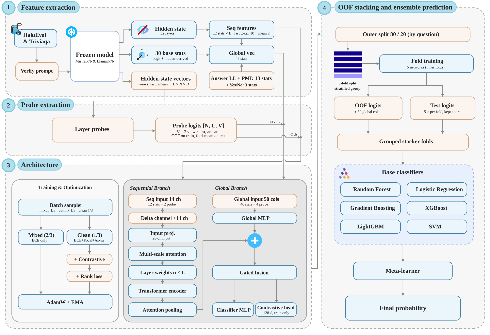

# Hidden-State Probes, Answer Likelihood, and Surface Shortcuts in White-Box Hallucination Detection

White-box hallucination detection for large language models (LLMs) using internal representations, evaluated on English HaluEval QA and a curated TriviaQA hard-negative dataset.



## Overview

The pipeline has three stages: `extract`, `train_oof`, and `ensemble`.

### 1. Extract 

A frozen LLM (4-bit NF4 quantization by default) reads each question–answer pair. Two feature configurations are available:

- **Base**: 12 statistics from each of 32 sampled hidden-state layers, plus 30 global features derived from the output logits.
- **v2**: the same scalar statistics, plus the full hidden-state vectors in two views (`last`, `amean`), a verification prompt (*"Is the proposed answer correct? Answer (Yes or No):"*), and answer-token likelihood / PMI features. Global features increase to 46 (30 base + 13 answer likelihood / PMI + 3 Yes/No log-probability).

With `--v2`, this stage also fits the **layer probes**. For each (view, layer) pair, an out-of-fold linear probe is trained:

`StandardScaler -> PCA(256) -> LogisticRegression(C=0.02)`

Folds are grouped by question. The probe logits are appended to the detector input.

### 2. Train OOF 

**MultiHaluDet** is trained independently in each of the 5 inner folds. It consists of:

- A sequential branch (multi-scale attention, Transformer encoder, attention pooling) over the layer axis.
- A global branch (MLP).
- A gated fusion of both branches, followed by a classifier head.

The objective combines BCE, Focal, Asymmetric, and Contrastive losses. Optimization uses AdamW with EMA, Mixup, and CutMix. Three optional components are disabled by default: delta channels (`--layer_delta`), layer-weight scaling (`--layer_scale`), and a pairwise AUC ranking loss (`--rank_weight`).

Each fold produces out-of-fold features and logits for the training split, and test outputs for the held-out split.

### 3. Ensemble 

The out-of-fold outputs are stacked. Base classifiers (RF, HistGB, LR, SVM, XGB, LGBM) are fitted with 5-fold cross-validation, and a logistic-regression meta-learner combines their log-odds.

- **Base**: the input is the 576-d feature vector from each fold network. Test features are averaged over the 5 networks before stacking.
- **v2**: the input is each network's out-of-fold logit plus the global features. The stacker is applied to the test logits of each network, and the 5 outputs are averaged.

`--stacker lite` uses only LR and LightGBM.

### What v2 Adds Over Base

| Component | Base | v2 |
|---|---|---|
| LLM features | 12 scalar statistics per sampled layer | Same 12 statistics, plus full hidden-state vectors (views `last`, `amean`) used to train layer probes. |
| Prompt | `Question: ... Answer: ...` | Verification prompt by default (`--prompt_mode verify`); plain prompt supported (`--prompt_mode plain`). |
| Answer likelihood | - | Answer-token log-likelihood, entropy, rank, and PMI against the question-free prompt (13 features); Yes/No log-probabilities with the verification prompt (3 features). |
| Probes | - | 32 layers × 2 views out-of-fold linear probes, fitted inside `extract`. |
| Global features | 30 | 43 (plain) or 46 (verify), plus 4 probe-derived values (2 per view) by default: 47 / 50. |
| Sequential channels | 12 per layer | 14 per layer by default (12 + 2 probe logits). |
| Optional components | `--layer_delta`, `--layer_scale`, `--rank_weight` (off by default) | Same flags, off by default. |
| Train/test split | By row | **By question** (both answers of a question stay in the same split). |
| Stacker | 5-fold by row; 576-d vector input (`--stack_mode vector`) | 5-fold by question; OOF-logit input (`--stack_mode logit`); vector input still available. |
| Stacker test prediction | Features averaged over the 5 networks, then stacked | Stacker applied to each network's logits, outputs averaged. |
| Additional metric | - | **Pair accuracy** (the incorrect answer scores higher than the correct one). |
| Optional configuration | - | `--pair_center` (subtracts the per-question mean). |

### Results Summary

The following table reports **the mean AUROC over 5 seeds (1,11,29,37,43)** achieved by Base and v2 across the two evaluation datasets.

| Dataset | Model | Base AUROC | v2 AUROC | Δ AUROC |
|---|---|---:|---:|---:|
| HaluEval | Mistral-7B | 0.9849 | **0.9931** | +0.0082 |
| HaluEval | Llama-2-7B | 0.9846 | **0.9917** | +0.0071 |
| TriviaQA | Mistral-7B | 0.6452 | **0.8226** | +0.1774 |
| TriviaQA | Llama-2-7B | 0.5931 | **0.7650** | +0.1719 |

## Installation

Clone the repository:

```bash
git clone https://github.com/dktllnk20/MultiHaluDet-plus.git
cd MultiHaluDet-plus
```

Install the dependencies:

```bash
pip install -r requirements.txt
```

### Hugging Face Authentication

Gated models (e.g., Llama-2) require a Hugging Face access token.

Create a `.env` file in the repository root and add your token:

```bash
echo "HF_TOKEN=hf_xxxxxxxx" > .env
```

The token is loaded automatically by `src/config.py`.

### Dataset Information

- **HaluEval:** Uses the English dataset located at `data/halueval.json`. If the file is unavailable, the pipeline automatically falls back to Hugging Face.
- **TriviaQA:** Expects `data/triviaqa.json`, containing exactly two records per question: one correct answer (label `0`) and one hard negative (label `1`). If the file is unavailable, the pipeline falls back to a version of TriviaQA with randomly generated incorrect answers.

> [!NOTE]
> The TriviaQA hard-negative dataset was derived from `lucadiliello/triviaqa` on Hugging Face and subsequently edited, manually verified, and relabeled. See [Dataset Information](DATASET.md) for further details and access instructions.

### Hardware

All experiments were conducted on a system equipped with:

- **CPU:** AMD Ryzen 7 7435HS
- **GPU:** NVIDIA GeForce RTX 4050 Laptop GPU (6 GB VRAM)

## Usage

### Running the Pipeline

Run the complete pipeline:

```bash
# baseline
python run_pipeline.py --models mistral-7b llama2-7b --dataset triviaqa halueval --stage all --seed 42

# v2
python run_pipeline.py --v2 --models mistral-7b llama2-7b --dataset triviaqa halueval --stage all --seed 42

```

Alternatively, execute each stage independently:

```bash
# Stage 1: Feature extraction
python run_pipeline.py --models mistral-7b --dataset halueval --stage extract

# Stage 2: Out-of-fold training
python run_pipeline.py --models mistral-7b --dataset halueval --stage train_oof

# Stage 3: Ensemble evaluation
python run_pipeline.py --models mistral-7b --dataset halueval --stage ensemble
```

### Research Questions

Run the experiments associated with each research question:

```bash
python run_pipeline.py --rq 1
python run_pipeline.py --rq 2
```

### Supported Models

- Mistral-7B (`mistral-7b`)
- Llama-2-7B (`llama2-7b`)

## Folder Structure

```text
src.
├── config.py
├── data/
│   ├── feature_extractor.py
│   ├── loader.py
│   ├── probe_extractor.py
│   └── splits.py
│
├── ensemble/
│   └── meta_learner.py
│
├── models/
│   ├── losses.py
│   └── multihaludet.py
│
├── probe/
│   └── layer_probe.py
│
├── rq/
│   ├── rq1.py
│   └── rq2.py
│
├── settings/
│   └── runtime.py
│
├── training/
│   ├── augmentations.py
│   └── trainer.py
│
└── utils/
    ├── bin_hist.py
    ├── metrics.py
    └── visualization.py
```

## Contact

Have questions about the project, want to reproduce the experiments, or are interested in learning more? Feel free to reach out!

- **Email:** [dktlln.k20@gmail.com](mailto:dktlln.k20@gmail.com)

Whether you have a question, feedback, or a collaboration idea, we'd be happy to hear from you.
